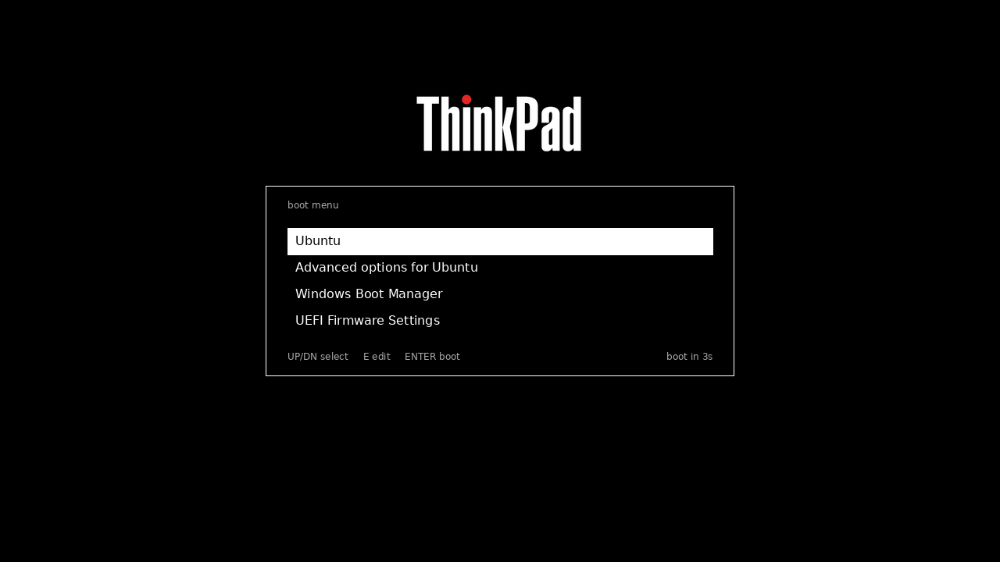

# ThinkGRUB

A minimal black & white GRUB 2 theme: one centered, white-bordered box on a
black background, a ThinkPad-style wordmark above it, and nothing else.



## Features

- Single 600x244 box, centered both horizontally and vertically
- Four boot entries visible at once
- White menu text; the selected entry is a white block with black text
- Gray title (`boot menu`) and gray footer hints (`UP/DN select  E edit  ENTER boot`, `boot in Ns`)
- No gradients, no bold, no icons, no scrollbar
- Fully generated from source: every asset is reproducible with `build.py`

## Install

```sh
git clone https://github.com/mschiller890/ThinkGRUB.git
cd ThinkGRUB
pkexec ./install.sh        # or: sudo ./install.sh
```

The installer:

1. copies the theme to `/boot/grub/themes/thinkgrub`
2. backs up `/etc/default/grub` to `/etc/default/grub.bak` (first run only)
3. sets `GRUB_THEME`, `GRUB_TIMEOUT=5`, `GRUB_TIMEOUT_STYLE=menu`
4. runs `update-grub`

Optional environment overrides: `DEST`, `TIMEOUT`, `GRUB_FILE`.

## Uninstall

```sh
pkexec ./uninstall.sh      # or: sudo ./uninstall.sh
```

Clears `GRUB_THEME`, removes the theme directory and regenerates `grub.cfg`.

## Requirements

- GRUB 2 with `gfxterm` (Debian/Ubuntu: package `grub-common`)
- To rebuild the assets:
  - `python3` + `python3-pil`
  - `grub-mkfont` (from `grub-common`)
  - `python3-gi` and the librsvg GdkPixbuf loader (`librsvg2-common`) for
    rendering `logo.svg`

## Rebuild / customize

```sh
python3 build.py
```

This regenerates `theme.txt`, all PNGs, the `.pf2` fonts and `preview.png`.
The layout constants are at the top of `build.py`:

| Constant | Meaning |
|---|---|
| `BOX_W`, `BOX_H` | box size in pixels |
| `LOGO_W`, `LOGO_H`, `LOGO_GAP` | wordmark size and distance above the box |
| `ITEM_H`, `ITEM_SPACING` | menu row height and gap (pitch = sum of both) |
| `BORDER`, `H_PAD` | 9-slice border thickness and text indent inside the highlight |
| `SIZES` | font sizes to generate (12, 14, 16) |
| `FONT_TTF` | source TTF for the fonts |

## GRUB quirks worth knowing

These are handled in `build.py`, but they explain why the theme looks the way
it does:

- **Fonts are matched by exact internal name**, including size, e.g.
  `DejaVu Sans Regular 12`. That is why one `.pf2` per size is generated and
  referenced by that name in `theme.txt`.
- **Canvas components are prepended and painted head-first**, so the first
  component in `theme.txt` ends up on top. The opaque panel image is therefore
  the **last** component.
- **A pixmap-style box is drawn as `top border + item_height + bottom border`**
  and its corners are never scaled. The vertical border (2px) plus
  `item_height` equals the row pitch, so the selection block fills exactly one
  row and never overlaps its neighbours.
- **Item text is indented by the style box's left-slice width**, which is how
  the 10px text padding inside the white highlight is achieved.

## Notes

- The theme is designed for a menu with up to four entries; more entries still
  work (the list scrolls), but the box shows four at a time.
- The ThinkPad wordmark (`logo.svg`) is a trademark of Lenovo. It is included
  as fan art and is **not** covered by this project's license. Replace it with
  your own logo, or delete the logo component from `theme.txt`, if you
  redistribute the theme.

## License

MIT - see [LICENSE](LICENSE). The bundled DejaVu font files are generated from
DejaVu Sans, which is distributed under the Bitstream Vera/DejaVu license.
